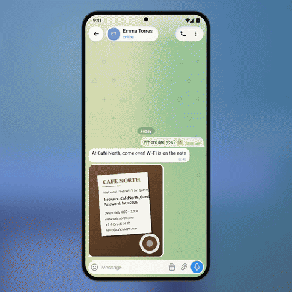

# 🔤 Text on Photos

Long-press a photo (or tap **Text**) and every line of text on it lights up. Tap lines to select
and copy them, or use the one-tap actions Telegram finds for you: **Copy Wi-Fi password**, open the
link, call the number, write the e-mail.

<p align="center"></p>

<p align="center"><b>&#9654;&#65039; <a href="demo.mp4">Full-quality video (demo.mp4)</a></b> &middot; Telegram for Android 12.4 design &middot; Android 8+</p>

## How it works

- `PhotoText` runs ML Kit text recognition on the device (bundled model, works offline) and finds
  links, phones, e-mails and `password:` lines.
- `PhotoTextOverlay` draws above the photo with the viewer's current matrix: dim, a scanner-like sweep,
  line highlights, tap to select.

## Integration into Telegram for Android

| Where | What |
|---|---|
| `PhotoViewer` | long press on the image (or the **Text** button) → `PhotoText.recognize(centerImage.getBitmap())`, cache per photo id |
| `PhotoViewer.onDraw` | draw `PhotoTextOverlay` with the current scale/translation, so it follows zoom and pan |
| Actions card | `Browser.openUrl`, `Intent.ACTION_DIAL`, clipboard + `BulletinFactory` |
| `build.gradle` | `com.google.mlkit:text-recognition` (Latin; other scripts are separate small modules) |

Files: [`PhotoText.java`](photo-text/src/main/java/org/telegram/ui/Components/PhotoText.java),
[`PhotoTextOverlay.java`](photo-text/src/main/java/org/telegram/ui/Components/PhotoTextOverlay.java).

## Build and run

Requirements: JDK 17 and the Android SDK (platform 36). Point Gradle at the SDK with
`local.properties` (`sdk.dir=/path/to/Android/sdk`) or `ANDROID_HOME`.

```
./gradlew :photo-text:assembleDebug
adb install photo-text/build/outputs/apk/debug/photo-text-debug.apk
```

The app opens on the demo screen and works by hand. For the presentation look of the video:

```
adb shell am start -n org.telegram.lab.phototext/.MainActivity --ez stage true --ez autoplay true
```

## Project layout

| Path | What it is |
|---|---|
| `photo-text/src/main/java/org/telegram/ui/Components/` | **the feature itself**, drop-in for Telegram's `TMessagesProj` (Android SDK + `AndroidUtilities` only) |
| `photo-text/src/main/java/org/telegram/lab/phototext/` | the demo screen and the scripted demo used for the video |
| `core/` | Telegram 12.4-style UI the demo is built on: chat screen, bubbles, composer, sheets, menus, Telegram's own icons |

## License

GPL-2.0, same as Telegram for Android, whose icons are included in `core`.